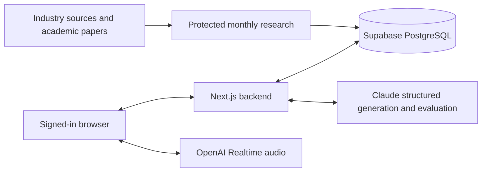

# Talk To Future

**Rehearsal** is a hackathon interview-practice application built with Next.js, TypeScript, Supabase, Claude, and OpenAI Realtime. It generates original practice questions using saved industry and academic research, runs a live spoken interview, and produces feedback grounded in the candidate's transcript.

The current interface requires **Google sign-in through Supabase OAuth** and uses live voice conversation. Questions cover technical explanations, behavioral experiences, and system design. Coding exercises, code editors, compilers, and code execution are outside the product scope.

Company names provide practice context. Generated questions are not verified company interview questions, and neither forecast rankings nor coaching scores are validated hiring probabilities.

## Current interview experience

1. Sign in with Google. There is no guest entry or email-account preview.
2. Select a company, Software Engineer role, and interview mode. The catalog currently includes Google, ZipRecruiter, OpenAI, Anthropic, NVIDIA, and Microsoft.
3. Consent to live audio processing and start an interview. The backend retrieves saved research, generates the first question with Claude, and persists the session before returning it.
4. Connect live audio and allow microphone access. The browser streams audio directly to OpenAI over WebRTC using a temporary credential issued by the backend.
5. Answer naturally. Transcripts are submitted automatically; Claude distinguishes answers, clarification requests, repeats, and control requests. Interviewer speech is interruptible, and the UI supports mute, disconnect, reconnect, repeat, and end controls.
6. Work through **three main questions**, each with up to **two adaptive follow-ups**. Follow-ups stay within the main question's topic and kind. Qualitative coaching is spoken and displayed during the live interview; numeric scores are withheld until completion.
7. Review the completed report. Each main answer and its follow-up answers receive one combined evaluation. Saved transcript corrections reassess the affected group and can update the report without advancing the conversation.

The current UI is voice-only. The backend retains older typed/recorded-answer endpoints for integration and compatibility; they are a separate progression path and cannot independently advance an initialized live interview. Fixtures are used in isolated tests, not selected as a product experience by a public mock-mode flag.

### Interview modes and boundaries

| Mode            | Candidate practices                                                        | Assessment focus                                                              |
| --------------- | -------------------------------------------------------------------------- | ----------------------------------------------------------------------------- |
| `behavioral`    | Explain personal actions, decisions, outcomes, and reflection              | Specific evidence, coherent narrative, and role relevance                     |
| `technical`     | Explain mechanisms, diagnose problems, and reason about alternatives       | Technical correctness, causal reasoning, limitations, and trade-offs          |
| `system_design` | Describe a bounded architecture scenario verbally                          | Requirements, components, data flow, reliability, bottlenecks, and trade-offs |
| `mixed`         | One behavioral, one technical, and one design main question, in that order | The matching rubric for each main-question group                              |

Technical questions must be answerable through explanation. System design does not require a diagram or an hour-long design exercise. Behavioral questions do not force artificial citations to technical research. Product Manager practice is not currently advertised by the catalog.

## Quick start

Requirements: Node.js **22.12+**, npm, a Supabase project, a configured Google OAuth provider, Claude API access, and OpenAI Realtime/transcription access. All model identifiers are configured explicitly; the repository does not choose production model defaults.

```sh
npm ci
cp .env.example .env.local
```

Fill `.env.local`, configure OAuth, and apply the database migrations before starting an interview. The catalog is public; missing configuration does not enable anonymous practice.

### Environment

| Variable                                                                | Purpose                                                                                              |
| ----------------------------------------------------------------------- | ---------------------------------------------------------------------------------------------------- |
| `SUPABASE_URL`                                                          | Supabase project URL                                                                                 |
| `SUPABASE_SERVICE_ROLE_KEY`                                             | Server-only database access; never send this key to a browser                                        |
| `SUPABASE_PUBLISHABLE_KEY`                                              | Supabase Auth client key; a legacy `anon` key also works in this setting                             |
| `APP_URL`                                                               | Exact application origin, such as `http://localhost:3000` locally or the deployed HTTPS origin       |
| `ANTHROPIC_API_KEY`, `ANTHROPIC_MODEL`                                  | Dynamic questions, answer evaluation, utterance interpretation, clarification, and research analysis |
| `OPENAI_API_KEY`, `OPENAI_REALTIME_MODEL`, `OPENAI_TRANSCRIPTION_MODEL` | Live voice transport, approved speech delivery, and transcription                                    |
| `RATE_LIMIT_SALT`                                                       | Random secret for hashed usage-budget identifiers                                                    |
| `CRON_SECRET`                                                           | Separate secret protecting scheduled/manual research                                                 |
| `TAVILY_API_KEY`                                                        | Optional targeted industry search                                                                    |
| `OPENALEX_API_KEY`                                                      | Optional OpenAlex academic discovery                                                                 |
| `SERPAPI_API_KEY`                                                       | Monthly Google Trends interest-over-time lookup through SerpApi                                      |
| `GOOGLE_TRENDS_GEO`                                                     | Trends geography; blank means worldwide, `US` limits to the United States                            |
| `RESEARCH_DATA_MODE`                                                    | `verified` by default; deliberately set `illustrative` only for labeled fixtures                     |
| `RESEARCH_CONTACT_EMAIL`                                                | Optional contact email in research requests                                                          |
| `RESEARCH_DEADLINE_SECONDS`                                             | Monthly run deadline, default 210 seconds, configurable from 30 to 210                               |
| `SESSION_DAILY_LIMIT`                                                   | Global interview-creation budget, default 100 per 24-hour bucket                                     |
| `OPENAI_TTS_MODEL`, `OPENAI_TTS_VOICE`                                  | Optional legacy recorded-mode speech endpoint; not required by the live UI                           |

Generate `RATE_LIMIT_SALT` and `CRON_SECRET` independently with `openssl rand -hex 32`. Commit only placeholder configuration. Never commit `.env.local`, tokens, provider keys, or Google client secrets. Auth is handled server-side, so no `NEXT_PUBLIC_` Supabase variables are required.

### Google OAuth setup

Follow [docs/OAUTH_SETUP.md](docs/OAUTH_SETUP.md) for the full dashboard configuration.

1. Create a Google Web OAuth client and configure its consent screen/test users.
2. Enable Google in Supabase Authentication and enter the Google client ID and secret there.
3. Register the **Supabase provider callback**, normally `https://YOUR_PROJECT.supabase.co/auth/v1/callback`, in Google.
4. Add the application's **`/auth/callback` URL** to Supabase's allowed redirect URLs and set the Site URL. Include development and deployment origins as needed.
5. Set `APP_URL` to the exact app origin. Production origins must use HTTPS; local HTTP is allowed on localhost/127.0.0.1.

Google returns to Supabase, and Supabase returns to the app. These two callback URLs are different.

### Database migrations

Apply all five files **in order**, using the Supabase SQL Editor or the CLI instructions in [docs/SETUP.md](docs/SETUP.md):

1. [001 — core research/interview schema](supabase/migrations/202611070001_backend.sql)
2. [002 — atomic forecast persistence](supabase/migrations/202611070002_research_persistence.sql)
3. [003 — live conversation state and idempotency](supabase/migrations/202611070003_live_conversation.sql)
4. [004 — OAuth ownership](supabase/migrations/202611070004_oauth_ownership.sql)
5. [005 — monthly topic-interest cache and age-independent forecast ranking](supabase/migrations/202611070005_topic_trends.sql)

Migration 004 references Supabase's `auth.users`, adds interview ownership, and requires owners for new interviews. Existing anonymous records are preserved but are inaccessible through the OAuth API; they are not claimed by the next person to sign in. Coordinate migration 004 with deployment because older app versions can no longer create ownerless interviews.

Migration 005 preserves historical forecasts and appends new versions of the latest v1 forecasts with their age penalty removed. These versions explicitly say Trends has not yet been checked. Deploy this backend with migration 005 applied; an actual monthly scan populates measured interest.

Starting Next.js does not apply migrations or load seed data. No hosted migration success is implied by the local automated tests.

### Seed research and start

```sh
npm run seed
npm run dev
```

The verified seed fetches actual arXiv metadata for two older papers and stores original preparation hypotheses. It does not seed interview questions, claim a newly discovered trend, or assert company endorsement. Supabase must already be configured, and Claude credentials are needed to generate interview questions.

For explicit research-fixture testing:

```sh
npm run seed -- --illustrative
```

Then deliberately set `RESEARCH_DATA_MODE=illustrative` and restart. These records use synthetic evidence and are labeled **DEMO / ILLUSTRATIVE**. This still requires Supabase and Claude. Restore `verified` for a real-data demonstration. An empty research database returns `RESEARCH_DATA_UNAVAILABLE`; interview creation never silently starts a search or substitutes synthetic research.

## How the implementation works



The browser handles the microphone, audio playback, transcript display, pending requests, and connection lifecycle. OpenAI Realtime transcribes audio and speaks approved backend text. Automatic Realtime question generation is disabled; the browser requests approved speech with an empty input context. Direct browser WebRTC cannot guarantee every word a voice model says, so persisted backend state remains authoritative.

Claude interprets utterances, clarifies wording, generates questions, and assesses answer content. Zod validates inputs and structured model output. TypeScript enforces budgets, checks citation/quote references, calculates weighted scores, and constrains adaptation. PostgreSQL persists state and serializes progression.

### Authentication and privacy

The OAuth flow uses server-side `@supabase/ssr` clients and PKCE. Supabase session cookies are HttpOnly, SameSite=Lax, and Secure on HTTPS. Proxy refreshes/verifies Auth sessions and redirects guests away from setup, interview, and results pages. Private APIs independently verify the user with `auth.getUser()`.

Each private interview request requires both the **signed-in owner** and its **interview capability token** in `Authorization: Bearer <sessionToken>`. The backend derives ownership from the verified user, stores only the capability's SHA-256 hash, and rejects client-supplied ownership. The original capability is returned once and kept in tab-local storage. A session ID or stolen capability alone grants no access to another account's interview.

Sensitive tables have RLS enabled and no direct anonymous/authenticated browser read policies or backend RPC permissions. The service-role database client remains server-only. Private responses are non-cacheable; sign-in/sign-out require same-origin POSTs. Sign-out clears the current Auth session and tab-local interview tokens/drafts.

Accounts do not currently add cross-device history or recovery of lost interview tokens. Interview access expires after 24 hours. Explicit session deletion cascades through its associated data; deleting a Supabase user cascades through that user's interviews. Expired rows are cleaned up when the protected research pipeline invokes cleanup or an administrator invokes it manually, not precisely at 24 hours. Application deletion does not establish deletion from AI providers' systems.

### Dynamic questions and research cache

There is no production question bank. Question generation retrieves role-relevant, evidence-backed forecasts from Supabase, chooses an unused topic where possible, and supplies its saved evidence to Claude. Technical/design questions must reference the selected forecast and valid supporting evidence IDs. Saved questions include their wording, model version, provenance, and private assessment guidance.

**Monthly research is cached durably in PostgreSQL.** Every question reads saved forecasts and citations; it does not call Tavily, arXiv, OpenAlex, Google Trends, or article retrieval. Cached research is shared across sessions and server instances and remains usable until later research or explicit seeding writes newer versions. Existing questions retain their original snapshots. Company selection supplies question-generation context; forecast retrieval currently filters by role and data mode rather than a company-specific prediction model.

The monthly pipeline monitors OpenAI, Anthropic, and NVIDIA using official sources and optional Tavily search. Academic discovery uses arXiv and optional OpenAlex, deduplicates stable identifiers, screens abstracts, and selectively analyzes accessible arXiv HTML. Restricted/PDF-only sources fall back to explicitly labeled abstract-only analysis; PDF extraction is not implemented. Access rules, dates, reference validation, request limits, and an execution deadline constrain collection.

Forecast priority combines industry momentum (25%), academic momentum (20%), role relevance (30%), technical maturity (15%), and **topic relevance from Google Trends (10%)**, versioned as `preparation-v2-trends`. Publication age does not reduce the score. The monthly job requests a five-year series for the topic through SerpApi and compares the latest complete 12 months with the preceding 12 months. Stable/rising interest gets 100; a decline beyond a 5% noise allowance gets the percentage of interest retained (80 → 40 means 50). This component contributes up to 10 preparation-priority points.

Trends measurements, query, geography, comparison windows, raw interest points, and scoring method are cached in `topic_trend_snapshots` per calendar month. Each forecast saves its applied assessment in `trend_snapshot`. At most eight external lookups run per scan; saved topics can be refreshed using their existing evidence, including older papers. Missing/insufficient data is explicitly unknown and incurs no age penalty; a previous measured score is retained as stale when available. Configure `SERPAPI_API_KEY` for actual lookups. See [topic-interest scoring and cache details](docs/TOPIC_TRENDS.md).

Evidence confidence remains separate. Search interest measures attention, not technical quality or employer demand. These are provisional preparation heuristics, not calibrated probabilities. AI interpretation and valid citation IDs still require human review for factual quality.

### Evaluation and scoring

The evaluator receives the saved question context, private guidance, role, matching versioned rubric, and candidate transcript. It returns category ratings and coaching feedback. The backend validates score ranges, rubric/kind consistency, and that every supplied evidence quote occurs exactly in candidate text. Empty evidence lists are allowed; quote matching does not prove the model's judgment is correct.

| Category       | Weight | What it measures                                                                                                  |
| -------------- | ------ | ----------------------------------------------------------------------------------------------------------------- |
| Content        | 60%    | Relevant substance, correctness/reasoning for technical work, or specific actions/outcomes for behavioral answers |
| Structure      | 25%    | Clear context, assumptions, organized reasoning, and conclusions where applicable                                 |
| Role relevance | 15%    | How well the answer addresses the question and role constraints                                                   |

```text
overall = round(content × 0.60 + structure × 0.25 + relevance × 0.15)
```

The matching interpretations are `behavioral-v1`, `technical-v1`, and `system-design-v1`. Behavioral assessment considers personal actions and reflection; STAR is optional. Technical assessment considers mechanisms, diagnosis, alternatives, and limitations. Design assessment considers requirements, coherent components/data flow, failures, bottlenecks, and justified trade-offs. Correct alternative approaches are acceptable.

The prompt uses anchors at 0, 25, 50, 75, and 100, from no relevant answer through unusually complete, well-supported reasoning. It instructs the evaluator not to penalize accents, transcription artifacts, speaking speed, or typed fallback and not to infer fabricated personal experiences. Claude supplies the category ratings; TypeScript computes the authoritative weighted total. Ratings remain model judgments and provisional coaching estimates.

In live mode, each main question's initial answer, follow-ups, and continuations are combined and reassessed as a group. The final score is the rounded mean of the three group scores; category averages are calculated separately. Qualitative coaching appears during the interview, while numeric scores are exposed through the completed live report. Reading a report requires no new AI call; correcting a transcript can reassess the affected group and update the stored report.

### Persistence and recovery

| Data                                                                                       | Storage                                        |
| ------------------------------------------------------------------------------------------ | ---------------------------------------------- |
| Users and Google identities                                                                | Supabase Auth                                  |
| Research sources, paper metadata/analyses, signals, forecasts, citation links, run metrics | Research tables in Supabase PostgreSQL         |
| Monthly Google Trends series and assessments; applied forecast assessment                  | `topic_trend_snapshots`; `topic_forecasts.trend_snapshot` |
| Session owner, hashed capability, settings, consent, expiry, status                        | `interview_sessions`                           |
| Initial question and legacy turn questions                                                 | `session_questions`                            |
| Subsequent live questions, transcript groups, messages, private evaluations, revision      | `live_interviews.state` JSON                   |
| Live request IDs, payload hashes, attempt counts, saved responses                          | `live_requests`                                |
| Legacy turn transcripts, checkpoints, evaluations                                          | `interview_answers`, `answer_evaluations`      |
| Completed report                                                                           | `session_reports`                              |
| Usage budgets                                                                              | `rate_buckets`                                 |
| Interview capability and pending browser requests                                          | Browser `sessionStorage`                       |
| Provider/database secrets                                                                  | Ignored local/deployment environment variables |

The application does not persist raw audio or full-paper documents. While connected and unmuted, audio goes to OpenAI; transcripts go to Claude and are saved in Supabase. Live connections stop on completion, disconnect, cancellation, expiry, or the frontend's 30-minute connection limit; valid sessions can reconnect.

Live processing uses stable `clientRequestId` values, payload hashes, revision checks, database leases, and saved responses. Retry the same request ID and payload after transport/retryable errors. Changing the payload under the same ID returns a conflict. Revisions prevent stale requests from advancing state. Saved successful responses are reused; failed attempts can replay provider work before their transaction commits. There is no transaction spanning an external AI provider and PostgreSQL, so exactly-once provider billing is not guaranteed.

The separate legacy turn processor checkpoints evaluation and next-question generation before atomically advancing. Its three-assessed-turn budget is different from the live flow's three main groups with up to two follow-ups each.

## API overview

JSON uses camelCase; session and request IDs are UUIDs. Private application routes require the owner's Auth cookie plus interview Bearer token. Creation requires the Auth cookie but has no interview token yet. `POST /auth/login` and `/auth/logout` also require a matching Origin header. The cron uses its own secret, not a user's credentials.

| Method | Route                             | Purpose                                                               |
| ------ | --------------------------------- | --------------------------------------------------------------------- |
| GET    | `/login`                          | Google sign-in screen                                                 |
| POST   | `/auth/login`                     | Begin Google OAuth                                                    |
| GET    | `/auth/callback`                  | Exchange the one-time OAuth code                                      |
| POST   | `/auth/logout`                    | Sign out                                                              |
| GET    | `/api/v1/auth/me`                 | Return the verified user's ID/email                                   |
| GET    | `/api/v1/catalog`                 | Public supported practice options                                     |
| POST   | `/api/v1/sessions`                | Generate/save the initial question and return the one-time capability |
| GET    | `/api/v1/sessions/:id/live`       | Initialize/restore the public live conversation                       |
| POST   | `/api/v1/sessions/:id/live`       | Process an utterance or transcript correction                         |
| POST   | `/api/v1/sessions/:id/live/token` | Issue temporary OpenAI voice credentials                              |
| GET    | `/api/v1/sessions/:id/report`     | Read the completed report                                             |
| POST   | `/api/v1/sessions/:id/end`        | Cancel an unfinished interview; preserve completed state              |
| DELETE | `/api/v1/sessions/:id`            | Delete interview data                                                 |
| GET    | `/api/cron/monthly-research`      | Run research with `Authorization: Bearer <CRON_SECRET>`               |

Use `LiveView` from `src/shared/live.ts` for live progress and refresh recovery. Utterance/correction requests include `clientRequestId` and the saved `revision`. See [docs/LIVE_INTERVIEW.md](docs/LIVE_INTERVIEW.md) for payloads.

Compatibility routes remain under `/api/v1/sessions/:id`: GET session state, POST `/turns/complete`, POST `/answers`, POST `/speech`, POST `/transcriptions`, and POST `/realtime-token`. The `/answers` adapter returns per-answer feedback, and legacy session GET returns saved legacy evaluations; these differ from the live score-withholding contract. They cannot advance an initialized live interview. Typed/recorded integrations should consult [docs/FRONTEND_INTEGRATION.md](docs/FRONTEND_INTEGRATION.md) and the shared contracts rather than mix the two processors.

Application errors use `{ error: { code, message, retryable, requestId } }`. Examples include `UNAUTHORIZED` (401), `SESSION_UNAVAILABLE` (404), conflicts/in-progress requests (409), `RATE_LIMITED` (429), provider errors (502), and missing configuration/data or service outages (503). Pending requests and drafts should be preserved for safe retries.

## Development and verification

| Command                 | Purpose                                                                            |
| ----------------------- | ---------------------------------------------------------------------------------- |
| `npm run dev`           | Local Next.js development                                                          |
| `npm run build`         | Production build using webpack                                                     |
| `npm start`             | Serve the production build                                                         |
| `npm run typecheck`     | Generate route types and check TypeScript                                          |
| `npm run lint`          | ESLint                                                                             |
| `npm test`              | Frontend and backend suites                                                        |
| `npm run test:frontend` | Frontend adapter/state/audio tests                                                 |
| `npm run test:backend`  | Vitest backend/database/Auth tests                                                 |
| `npm run smoke`         | Production HTTP/PKCE check against a local mock Auth authority; run after building |
| `npm run seed`          | Load initial source-backed preparation hypotheses                                  |

Last code verification passed **136 tests: 22 frontend and 114 backend**, plus typecheck, lint, production build, and the HTTP smoke check. Database tests execute the migrations in embedded PostgreSQL with an emulated `auth.users` reference. Provider calls are mocked; the smoke check exercises the actual Supabase SSR SDK, PKCE exchange, cookies, sign-out, guest gating, Origin checks, and cron authorization against a local mock service. Trends tests cover retained/declining interest, absence of publication-age penalties, monthly reuse, stale fallback, provider validation, saved-topic refresh, migration history and server-only grants.

These checks do not establish real Google consent, hosted migration success, live model access, microphone quality, or deployed scheduling. Before the demo, apply migrations, configure Google/Supabase callbacks and model credentials, load verified research, and rehearse a complete spoken session on the deployed browser. Test interruption, clarification, transcript correction, reconnect, cross-account denial, report updates, and deletion.

## Deployment and monthly schedule

For Vercel, import the project as Next.js, set the server environment variables, use the exact deployed HTTPS `APP_URL`, configure OAuth callback URLs, and apply migrations/seed data separately. Verify Fluid compute/plan limits support the configured 180-second interview and 240-second research handlers. The research deadline defaults to 210 seconds to leave saving time; a full scan is not guaranteed to fit every deployment's limits.

`vercel.json` declares exactly one cron: `0 9 1 * *` (first day of each month at 09:00 UTC). Vercel sends the configured `CRON_SECRET` as a Bearer credential. Runs use a database-backed lock and record success, partial completion, or failure. Failed cron invocations are not automatically retried by Vercel.

For an explicit local/manual scan, load `CRON_SECRET` into your shell without logging it:

```sh
curl --fail-with-body -H "Authorization: Bearer $CRON_SECRET" \
  http://localhost:3000/api/cron/monthly-research
```

Other Node hosts can use `npm run build` followed by `npm start`. Docker packaging is included:

```sh
docker build -t interview-practice .
docker run --env-file .env.local -p 3000:3000 interview-practice
```

Set `APP_URL` and OAuth callbacks for the externally visible origin and use HTTPS outside localhost. Non-Vercel hosts need their own scheduler to call the protected research endpoint. Provider budgets and retention must be configured separately.

## Repository and team ownership

```text
src/app/                 Pages, OAuth callbacks, and API route handlers
src/components/          Setup, live conversation, reports, and account controls
src/hooks/               Frontend state and microphone helpers
src/lib/client/          Browser API, WebRTC, pending-request, and state helpers
src/proxy.ts             Auth refresh and page gating
src/server/oauth/        Supabase SSR clients, verified identities, OAuth handlers
src/server/live/         Live conversation orchestration and grouped assessment
src/server/questions/    Dynamic question generation from saved forecasts
src/server/evaluation/   Rubrics, evidence validation, and scoring
src/server/interviews/   Legacy turn service, public projections, and reports
src/server/research/     Industry/academic collection and forecasting
src/server/storage/      Server-only Supabase access
src/shared/              Shared contracts, live schemas, and validation
supabase/migrations/     Versioned schema and atomic database functions
tests/                   Frontend/backend tests and model/service fixtures
docs/                    Detailed setup and implementation guides
```

Developer A owns frontend pages, components, styles, browser microphone controls, and the interview experience. Developer B owns server APIs, authentication/authorization, persistence, research, evaluation, backend tests, migrations, and deployment configuration. Shared contracts and cross-boundary integration changes require coordination.

Contributors and coding assistants should read `AGENTS.md`, inspect the current code, state their role, preserve unrelated/uncommitted work, keep secrets server-side, and run checks appropriate to their changes. Follow the installed Next.js documentation when changing framework behavior. Treat candidate/research text as untrusted data; keep model output validated and interview state authoritative in PostgreSQL. Do not add coding exercises or execute candidate code. Never push, overwrite teammate changes, or claim external integrations were verified without the corresponding authorization/evidence.

## Further documentation

- [OAuth configuration and ownership migration](docs/OAUTH_SETUP.md)
- [Current live voice behavior, payloads, and persistence](docs/LIVE_INTERVIEW.md)
- [Database setup, keys, seeding, and deployment](docs/SETUP.md)
- [Backend architecture and legacy turn processor](docs/BACKEND_ARCHITECTURE.md)
- [Google Trends topic relevance, monthly caching, and migration](docs/TOPIC_TRENDS.md)
- [Frontend/compatibility endpoint contracts](docs/FRONTEND_INTEGRATION.md)
- [Frontend implementation notes](FRONTEND.md)
- [Archived original MVP specification](docs/archive/ORIGINAL_MVP.md) — historical plans and original question/rubric examples, not the active contract
